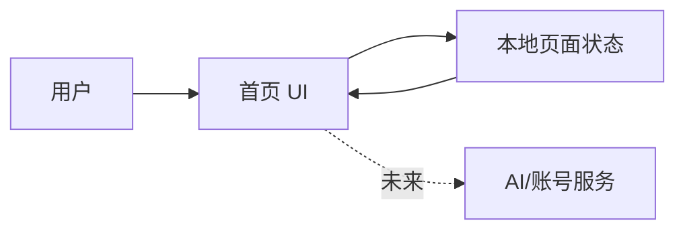

# 架构

## 系统边界

本项目是单页前端原型。浏览器加载本地静态资源，由页面状态驱动导航、创作、画布、工作流、内容资产和账户域的演示交互。首个版本不访问参考站接口，真实接口按产品域逐步替换本地适配层。

## 模块

- `src/app/`：路由入口、全局布局与主题状态。
- `src/features/creator/`：AI 创作入口、生成任务和创作记录。
- `src/features/canvas/`：无限画布节点编辑与画布市场。
- `src/features/workflow/`：工作流步骤配置、执行状态和历史。
- `src/features/library/`、`src/features/assets/`：模板、广场和素材库。
- `src/features/account/`：账户、团队、套餐和任务记录演示。
- `src/components/`：跨域侧栏、顶部栏、弹层、卡片和反馈组件。
- `src/data/`：演示用模板、项目、素材、账户和统计数据。
- `src/styles/`：颜色、间距、响应式断点和主题变量。

## 设计边界

- 视觉基线参考公开页面中已确认的蓝色主色、浅色工作台、卡片化模板入口和“无限画布 / 工作流 / 模板库 / 画布广场”模块。
- 未确认的登录用户信息与业务数据使用中性演示数据，并在代码中保持可替换。
- 真实服务接入边界以用户确认结果和后续可用 API/权限为准；在此之前不读取或复用参考站登录凭据。
