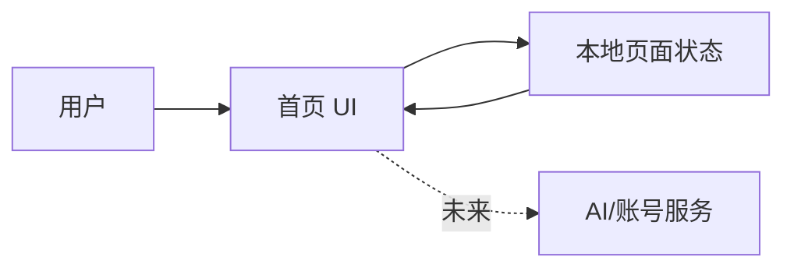

# 架构

## 系统边界

本项目是单页前端原型。浏览器加载本地静态资源，由页面状态驱动导航、模板筛选、创作入口和演示反馈。首个版本不访问参考站接口。

## 模块

- `src/App.*`：路由入口与全局布局。
- `src/components/`：侧栏、顶部栏、创作卡片、模板卡片等可复用界面。
- `src/data/`：演示用模板、最近项目与统计数据。
- `src/styles/`：颜色、间距、响应式断点和主题变量。

## 设计边界

- 视觉基线参考公开页面中已确认的蓝色主色、浅色工作台、卡片化模板入口和“无限画布 / 工作流 / 模板库 / 画布广场”模块。
- 未确认的登录用户信息与业务数据使用中性演示数据，并在代码中保持可替换。
